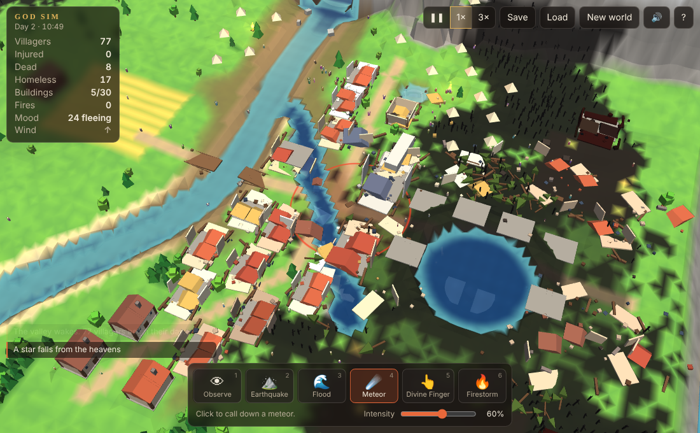

# Ruin of Gods

A browser god-sim destruction sandbox. You are the god: break a living valley with an earthquake, flood, meteor, divine finger, firestorm or lightning. Everything you break stays broken, and the survivors carry on.

## Play
Open `index.html` in any WebGL2 browser. It is one self-contained file, with no server and no dependencies.

## Controls
| Input | Action |
|---|---|
| 1-7 | Observe, Earthquake, Flood, Meteor, Divine Finger, Firestorm, Lightning |
| Left mouse | Use the power (Observe: drag to pan, click a villager to follow) |
| Right-drag | Rotate and tilt |
| Shift-drag / middle-drag | Pan while a power is selected |
| Wheel | Zoom |
| WASD / arrows, Q E, R F | Move, rotate, tilt |
| [ ] | Intensity |
| Space, M, H | Pause, mute, help |
| Touch | One finger uses the power; two fingers pan, pinch and twist |

Lightning darkens the sky, blasts one huge bolt down, then hurls a barrage of forks that seek the tallest buildings and trees; strikes on water electrocute anyone wading.

The dam upstream of the village can be breached with the Flood power. Save and Load keep terrain, water, scorch, fractures, rubble, building damage, villagers and tents (browser local storage).

## Layout
- `src/sim.js`: simulation core (no DOM): terrain, water, fire, structures, villagers, powers, save/load
- `src/render.js`: WebGL2 renderer and particles
- `src/audio.js`: procedural WebAudio
- `src/main.js`, `src/template.html`: input, HUD, game loop, page shell
- `build.js`: bundles `src/` into `index.html` (`node build.js`)
- `tests/test_sim.js`: headless simulation tests (`node tests/test_sim.js [seed]`)
- `tests/accept.js`: browser playthrough with real mouse and keyboard (needs `playwright` and Chrome with WebGL2)

## Known limitations
Frame rate is unmeasured on real GPUs, sound and touch have not been tested by ear or on a phone, saves are a single browser slot, and flood severity varies with the generated world.
